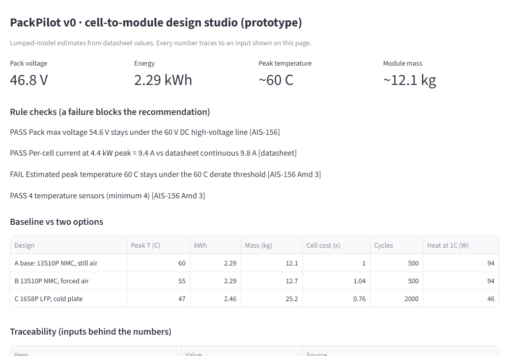

# PackPilot v0 — cell-to-module battery design studio (prototype)

Round 1 prototype for **Tata Elxsi TELIPORT Season 4, Case Study 2: Reusable Digital Platform for Designing Battery Energy System**.

PackPilot lets a student or pack engineer pick real cells from a datasheet library, set the series/parallel layout, cooling and sensing, and see in minutes whether a 48 V two- or three-wheeler module is safe, how hot it runs, what it weighs and costs. Every number traces to an input shown on the page.



## What v0 does today

- **Design under test**: cell (Samsung INR21700-50E NMC or Keeppower IFR32700 LFP), series count, parallel count, cooling (still air / forced air / cold plate), number of temperature sensors, ambient temperature, ride duration at 1C.
- **Rule checks** (a failure blocks the recommendation): pack maximum voltage under the 60 V DC high-voltage line (AIS-156); per-cell current at 4.4 kW peak against the datasheet continuous limit; estimated peak temperature under the 60 °C derate threshold (AIS-156 Amendment 3); minimum four temperature sensors (AIS-156 Amendment 3).
- **Baseline vs two options**: A = 13S10P NMC in still air, B = same with forced air, C = 16S8P LFP on a cold plate. Peak temperature, energy, mass, relative cell cost, cycle life, heat at 1C.
- **Traceability**: the inputs behind the numbers, with their source.

With the default inputs the baseline fails the 60 °C rule and the forced-air option passes.

## What v0 is not

A lumped single-node thermal estimator on datasheet values (`packpilot/estimates.py`). Round 2 replaces it with a pulse-fitted equivalent-circuit model, a module thermal network, an ageing model with an ML state-of-health layer, a fast ML surrogate for trade-off sweeps, and a full rule engine with interface-conflict checks. Numbers shown by v0 are estimates and are labelled as such.

## Run

```bash
python -m venv .venv
.venv\Scripts\python -m pip install -r requirements.txt     # Windows
python -m streamlit run packpilot/app.py
```

Open http://localhost:8501. `python packpilot/estimates.py` prints the A/B/C table on its own.

## Model and assumptions (v0)

- Heat generation per cell: I²R at 1C with the datasheet DC resistance.
- Module heat capacity: cell mass × 912 J/(kg·K) plus structure at 500 J/(kg·K).
- Convective coefficient h: 8 (still air), 30 (forced air), 150 (cold plate, base area only) W/(m²·K).
- Module mass: 1.35 × cell mass, plus fan or plate mass for options B and C.
- Scenario: 30-minute ride at 1C average, 45 °C ambient, module starting at ambient.

All assumptions are listed in `packpilot/estimates.py` and on the Traceability panel of the app.

## Licence

MIT for the code in this repository. Cell datasheet values belong to their manufacturers and are quoted for engineering comparison.
